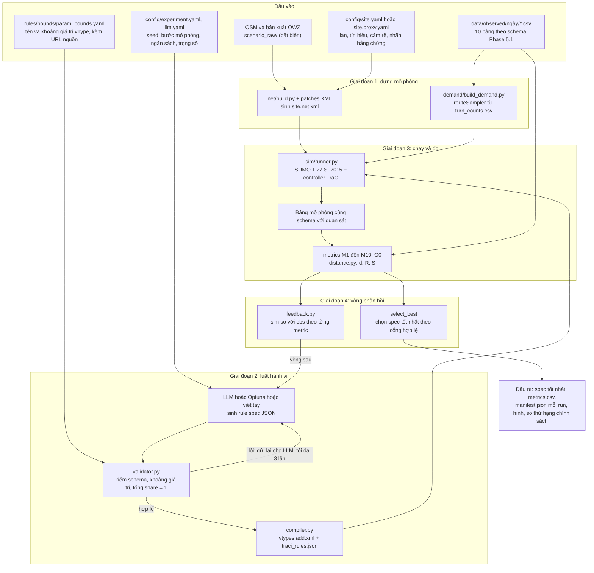
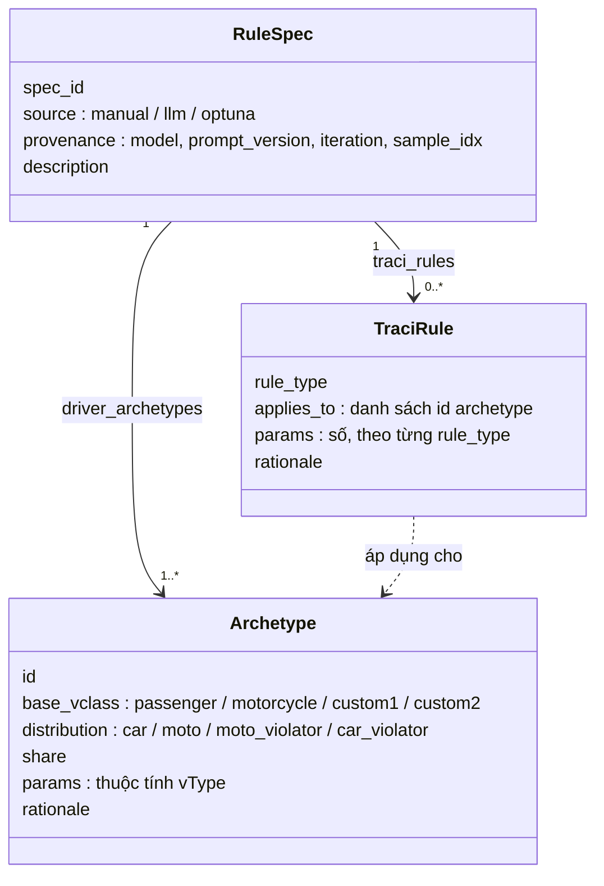
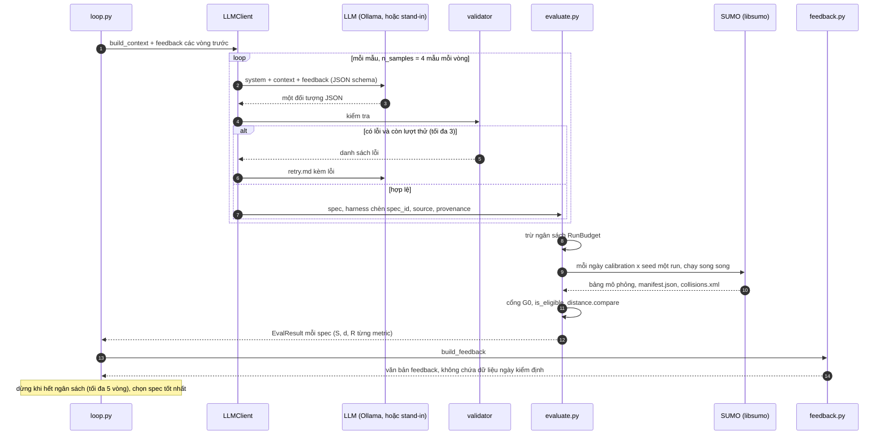
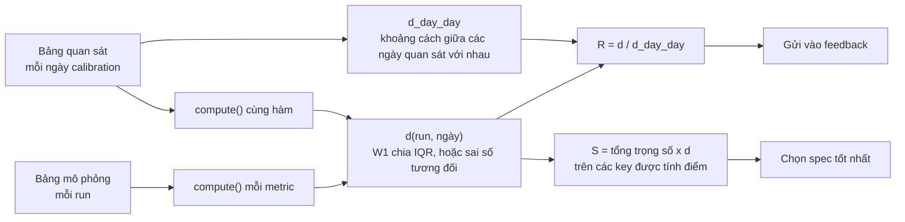
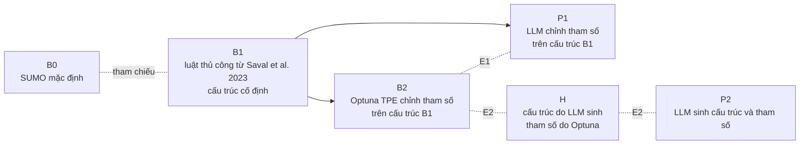

# Quy trình hiệu chỉnh luật hành vi tài xế bằng LLM trong SUMO

Tài liệu này mô tả toàn bộ quy trình của luận văn từ dữ liệu đầu vào đến kết quả đầu ra, để trình bày với hội đồng phản biện. Mọi con số lấy từ `PLAN.md`, `config/*.yaml`, `docs/PROGRESS.md` và các tệp trong `experiments/`. Phần nào chưa đo, chưa chạy hoặc đang dùng thay thế được ghi riêng ở mục 9.

## 1. Bài toán và câu hỏi nghiên cứu

SUMO mặc định giả định người lái tuân thủ tín hiệu và làn đường. Ở nút giao Lê Văn Lương x Hoàng Đạo Thúy (Thanh Xuân, Hà Nội), giờ cao điểm sáng 07:30 đến 09:00, xe máy vượt đèn đỏ, xuất phát trước đèn xanh, đi sai làn, chặn làn rẽ phải liên tục, đi trên vỉa hè và chờ giữa nút để rẽ trái trái phép. Mô phỏng mặc định (B0) không tái hiện các hành vi này.

Đề tài thử một cách hiệu chỉnh khác: một LLM chạy cục bộ viết tập luật hành vi dưới dạng JSON, một bộ kiểm tra và bộ biên dịch chuyển JSON thành đầu vào SUMO, SUMO chạy, các metric so mô phỏng với quan sát, và kết quả được đưa lại cho LLM để viết lại luật. Có hai câu hỏi:

- E1 (cấu trúc cố định): LLM chỉnh tham số có tốt hơn Optuna chỉnh tham số trên cùng cấu trúc không (P1 so với B2).
- E2 (cấu trúc do máy sinh): để LLM tự viết cả cấu trúc luật (P2) hoặc cấu trúc do LLM sinh rồi Optuna chỉnh tham số (H) có tốt hơn cấu trúc thủ công của B1 sau khi Optuna chỉnh không (B2 so với H so với P2).

Mục đích cuối là dùng mô hình đã hiệu chỉnh để so thứ hạng các phương án tổ chức giao thông giữa SUMO mặc định và mô hình đã hiệu chỉnh. Bước này chỉ chạy khi mô hình tốt nhất đạt R ≤ 1 trên ngày kiểm định (PLAN 7.6).

## 2. Sơ đồ tổng thể



## 3. Dữ liệu đầu vào

### 3.1 Mạng đường

Mạng được dựng bằng script, không sửa tay tệp `.net.xml`.

| Bước | Tệp | Nội dung |
|---|---|---|
| 1 | `scenario_raw/2026-10-02-06-34-26/` | bản xuất OWZ từ OSM, bất biến, lưu bằng Git LFS |
| 2 | `scenario/net/base.net.xml` | mạng gốc từ OSM, sinh bằng script |
| 3 | `scenario/net/patches/*.xml` | bản vá XML thuần: cắt nút giao, làn rẽ phải liên tục, dải vỉa hè cho `custom1` |
| 4 | `scenario/net/site.proxy.net.xml` | mạng cuối dùng để chạy |

Nút giao có 4 nhánh `LVL_W`, `LVL_E`, `HDT_N`, `HDT_S`, mỗi nhánh 3 làn rộng 3,5 m. Làn 0 (ngoài cùng bên phải) là làn rẽ phải liên tục chỉ ở 30 m cuối trước vạch dừng (`right_lane_length_m`, Viktor 29/10); thượng nguồn cả ba làn là làn thường. Ở 30 m cuối, rẽ phải từ làn 0 không bị đèn điều khiển, đi thẳng theo đèn đi thẳng của nhánh và hợp lệ khi xanh (Viktor 28/10: không có cọc phân cách, xe đổi làn tự do giữa làn 0 và làn 1). Xe có ý định đi thẳng, rẽ trái hoặc quay đầu mà dừng chờ đèn đỏ của hướng mình ở đoạn này chặn xe rẽ phải (hành vi 6); hành vi này đến từ việc chọn làn của SUMO và hàng chờ, không có lựa chọn `right_lane` của luật `queue_space_seeking` trên mạng này. Rẽ trái (nhánh không cấm) và quay đầu từ làn 0, quay đầu từ làn 1, là connection chỉ cho `custom1` và `custom2`, theo đèn rẽ trái; xe đi vào lúc đèn đỏ là vượt đèn đỏ. Nhánh `LVL_W` và `LVL_E` có vỉa hè đi được từ 170 m trước vạch dừng, rộng 3,0 m. Rẽ phải khi đèn đỏ là hợp lệ và không được tính là vi phạm.

### 3.2 Thông số hiện trường

`config/site.yaml` là nơi duy nhất chứa giá trị đo thực tế (bề rộng làn, chu kỳ đèn, cấm rẽ, lưu lượng). Giá trị chưa đo ghi `null  # TODO_MEASURE` và code báo lỗi rõ ràng khi gặp, không điền mặc định. Hiện chưa có video, nên mọi lần chạy dùng `config/site.proxy.yaml` với nhãn nguồn `LITERATURE_PROXY` trên từng giá trị (`literature`, `literature_transferred`, `assumed`). Tín hiệu trong tệp proxy: chu kỳ 120 s, 3 pha: `LVL_straight` 42 s, `LVL_left` 16 s (mũi tên riêng cho cả hai nhánh LVL), `HDT_green` 44 s, mỗi pha thêm vàng 4 s và đỏ toàn phần 2 s.

### 3.3 Dữ liệu quan sát

Mỗi ngày là một thư mục `data/observed/<ngày>/` gồm 10 bảng CSV và một `manifest.json`. Pipeline video sau này phải xuất đúng các bảng này; phía mô phỏng xuất cùng schema để dùng chung một bộ hàm metric.

| Tệp | Cột chính | Metric dùng |
|---|---|---|
| `turn_counts.csv` | interval_start, interval_end (15 phút), approach, movement (l/s/r/u/illegal_l), vclass, count | dựng demand, cổng G0 |
| `signal_events.csv` | t, approach_group, state (G/y/r) | M2, M3 |
| `stopline_crossings.csv` | t, approach, lane_or_lat_m, vclass, track_id, signal_state_at_t | M1, M2, M3 |
| `queue_snapshots.csv` | cycle_id, t_green_onset, approach, queue_length_m, n_car, n_moto, area_m2 | M5 |
| `lateral_snapshots.csv` | cycle_id, approach, track_id, vclass, lat_m, long_m_from_stopline | M4 |
| `traversals.csv` | track_id, vclass, approach, movement, exit_approach, lat_m_at_stopline, t_range_entry, t_stopline, t_exit | M6, M8 |
| `box_queue.csv` | cycle_id, t, approach, n_waiting_in_box, t_clear_start, t_clear_end | M7 |
| `queue_timeseries.csv` | t, approach, queue_length_m, n_car, n_moto | F2 |
| `space_seeking_events.csv` | t, cycle_id, approach, track_id, vclass, space, queue_length_m_at_t | F2, M9, M10 |
| `right_turn_delay.csv` | track_id, approach, vclass, t_enter, t_exit, blocked | M9 |

Có 5 ngày `PROXY_D1` đến `PROXY_D5`, sinh bằng `thesis_sumo.proxy.generate` từ các giá trị mục tiêu trong `data/proxy/targets.yaml` nhân với hệ số ngày (xem `day_factors` trong manifest mỗi ngày). Đây là dữ liệu sinh từ tài liệu, không phải dữ liệu đo ở nút giao. Thư mục `SYNTHETIC/` chỉ để thử pipeline và không bao giờ vào kết quả.

Cách chia ngày (`experiment.yaml`):

| Tập | Ngày | Ai được thấy |
|---|---|---|
| calibration | PROXY_D1, D2, D3 | LLM và Optuna thấy thống kê của các ngày này |
| validation | PROXY_D4, D5 | không bên nào thấy cho đến benchmark cuối |

`feedback.py` chạy `assert_no_day_data` trên mọi văn bản đưa vào prompt và ném `DayDataLeak` nếu có dữ liệu ngày kiểm định.

### 3.4 Nhu cầu giao thông

`demand/build_demand.py` lấy `turn_counts.csv` của từng ngày và dùng `routeSampler` trên tập tuyến ứng viên (`candidate_routes.rou.xml`) để sinh `routes_<ngày>.rou.xml`. Xe tham chiếu ba `vTypeDistribution`: `car`, `moto`, `moto_violator` (nhóm rẽ trái trái phép). Mỗi distribution cần ít nhất một archetype.

### 3.5 Tham số mô phỏng

| Tham số | Giá trị | Nguồn |
|---|---|---|
| Bước mô phỏng | 0,1 s | `experiment.yaml` |
| Mô hình đổi làn | SL2015 (sublane), độ phân giải ngang 0,4 m | `experiment.yaml` |
| Thời gian chạy hiệu chỉnh | 1800 s (07:30 đến 08:00) | `calib_end_s`, R31 |
| Cửa sổ tính metric | [300, 1800) s, 300 s đầu là khởi động | `metric_window_s` |
| Bán kính ghi fcd | 220 m quanh tâm nút | `fcd_radius_m` |
| Backend | libsumo (nhanh); traci khi cần gỡ lỗi bằng sumo-gui | `backend` |
| Phạm vi quan sát hàng chờ | 80 m trước vạch dừng | `queue_range_m` |

## 4. Rule spec: thứ LLM phải viết

Rule spec là một đối tượng JSON theo `rules/schema/rule_spec.schema.json`. LLM không sinh hay sửa mạng đường; nó chỉ quyết định tỷ trọng kiểu tài xế, tham số và điều kiện kích hoạt.



Phần `driver_archetypes` đặt thuộc tính vType (tĩnh, chạy trong SUMO): `tau`, `minGap`, `accel`, `decel`, `sigma`, `speedFactor`, `speedDev`, `minGapLat`, `maxSpeedLat`, `latAlignment`, `lcSublane`, `lcPushy`, `lcPushyGap`, `lcAssertive`, `lcImpatience`, `impatience`, `jmDriveAfterRedTime`, `jmDriveRedSpeed`, `jmTimegapMinor` và các thuộc tính khác trong `param_bounds.yaml`. Mỗi dòng của tệp này có khoảng giá trị, giá trị mặc định của SUMO và URL tài liệu SUMO làm nguồn.

Phần `traci_rules` là hành vi có điều kiện, do controller TraCI thực thi lúc chạy:

| rule_type | Hành vi | Tham số |
|---|---|---|
| `swarm_red_running` | vượt đèn đỏ, xác suất tăng theo số xe đã vượt trước đó | p0, k, p_max, dt |
| `early_start` | xuất phát trước khi đèn xanh | t_before_green, p, v_max |
| `queue_space_seeking` | hàng chờ dài thì đi sai làn, chặn làn rẽ phải (chỉ khi có cọc; mạng proxy hiện không có), hoặc lên vỉa hè | q, t_g_s, est_noise, p_wrong_lane, p_right_lane, p_sidewalk, v_creep, merge_zone_m |
| `illegal_left_box` | vào nút trong pha xanh, chờ giữa nút, rẽ khi pha đi thẳng đối diện kết thúc | theo `TRACI_RULE_PARAMS` |
| `slow_lane_center` | xe máy đi chậm giữa làn | theo `TRACI_RULE_PARAMS` |

Các lớp xe: `passenger` (ô tô, distribution `car`), `motorcycle` (xe máy, `moto`), `custom1` (xe máy vi phạm: `moto_violator` là người rẽ trái trái phép, hoặc `moto` là người đi thẳng có thể tìm khoảng trống), `custom2` (ô tô vi phạm). Chỉ `custom1` được dùng vỉa hè.

### 4.1 Kiểm tra và biên dịch

`validator.py` từ chối spec khi:

- thuộc tính không có trong `param_bounds.yaml` hoặc giá trị ngoài khoảng của lớp xe đó;
- tổng `share` trong một distribution khác 1;
- id archetype trùng, không bắt đầu bằng chữ, hoặc bắt đầu bằng `DEFAULT_` (SUMO âm thầm định nghĩa lại các vType mặc định này);
- `source = llm` nhưng thiếu `provenance` hoặc `rationale`;
- ở chế độ `params_only`, cấu trúc khác với spec gốc (mã lỗi `structure_locked`).

Spec hợp lệ qua `compiler.py` ra hai tệp trong `rules/compiled/<spec_id>/`:

| Tệp | Nội dung |
|---|---|
| `vtypes.add.xml` | mỗi distribution một `vTypeDistribution`, mỗi archetype một `vType` với `probability` = share và `laneChangeModel="SL2015"`; mọi tham số ghi tường minh |
| `traci_rules.json` | ánh xạ archetype sang id vType và từng rule kèm `vtype_ids`; controller dùng `vehicle.getTypeID` để biết xe nào chịu rule nào |

Đầu ra của compiler xác định (cùng spec cho cùng byte trên Windows và Linux).

## 5. Vòng lặp LLM



### 5.1 Prompt

Prompt có phiên bản (`prompts/v001/`) và gồm ba phần:

| Message | Template | Nội dung |
|---|---|---|
| system | `system.md` | vai "traffic-simulation modeller", ràng buộc cứng, mục tiêu giảm khoảng cách có trọng số giữa mô phỏng và quan sát |
| user (ngữ cảnh) | `context.md` | chế độ (`params_only` hoặc `full`), spec gốc (chỉ `params_only`), mô tả nút giao kèm nhãn bằng chứng, 10 hành vi trong phạm vi, từ điển tham số sinh tự động từ `param_bounds.yaml`, mục tiêu quan sát của các ngày calibration, JSON schema đầu ra |
| user (mỗi vòng trước) | `feedback.md` | spec của vòng đó ở dạng JSON gọn, từng metric: giá trị mô phỏng, giá trị quan sát, chiều sai, d, R, trọng số; số lần can thiệp TraCI; lỗi validator |

Ví dụ thực tế nằm ở `experiments/llm_logs/P1/requests/P1__it02_s00_a1.json` (3 message, khoảng 84 nghìn ký tự).

### 5.2 Phản hồi

LLM trả một JSON gồm `driver_archetypes`, `traci_rules`, `description` tùy chọn, và mỗi phần tử có `rationale` nêu metric nhắm tới. Trích từ `experiments/llm_logs/P1/responses/P1__it02_s00_a1.json` (vòng 2):

```json
{
  "id": "moto_saval",
  "base_vclass": "motorcycle",
  "share": 0.9,
  "params": {"accel": 2.5, "decel": 4.6, "tau": 0.6, "minGap": 1.0, "minGapLat": 0.3},
  "rationale": "Targets M1/moto (sim 0.82-0.88 s vs obs 0.30 s headway), M5/length (73 m vs 13 m)..."
}
```

Ở vòng 1, tất cả spec bị kẹt xe (headway ô tô 1,6 s so với 0,39 s quan sát, hàng chờ 74 m). Vòng 2 hạ `tau`, `minGap` và tăng `accel` để xả hàng nhanh, đồng thời nâng xác suất vượt đỏ và xuất phát sớm.

### 5.3 Hai chế độ

| Chế độ | Thí nghiệm | Spec gốc | LLM được đổi |
|---|---|---|---|
| `params_only` | P1 | `B1_manual.json` | chỉ `share` và giá trị số; đổi cấu trúc bị từ chối với `structure_locked` |
| `full` | P2 | không có (không dùng cả làm ví dụ) | cả cấu trúc lẫn tham số |

## 6. Mô phỏng và các metric

### 6.1 Một lần chạy

`sim/runner.py` nhận một spec đã biên dịch, một ngày, một seed, rồi gọi SUMO với mạng, demand của ngày đó và `vtypes.add.xml`. Controller TraCI chạy `traci_rules.json` mỗi bước. Mỗi run ghi `manifest.json` (spec, seed, hash tệp, số va chạm lane và junction, số teleport, tồn đọng cuối) và `collisions.xml`. Raw fcd/tripinfo không được theo dõi bằng Git.

### 6.2 Các metric

| Nhóm | Đo gì | Bảng nguồn |
|---|---|---|
| G0 | GEH của số đếm rẽ theo 15 phút; cần GEH < 5 cho ít nhất 85% ô, run trượt bị loại; không tính điểm | `turn_counts` |
| M1 | headway xả sau đèn xanh, theo vị trí trong hàng và lớp xe | `stopline_crossings` |
| M2 | tỷ lệ xe qua vạch trong N giây cuối đèn đỏ; độ trễ của xe đầu tiên sau đèn xanh | `stopline_crossings`, `signal_events` |
| M3 | số vi phạm đèn đỏ mỗi chu kỳ (kèm variance/mean); xác suất vi phạm khi đã có xe vi phạm trước | `stopline_crossings` |
| M4 | vị trí ngang của xe máy lúc đèn chuyển xanh; mức vượt qua vạch | `lateral_snapshots` |
| M5 | chiều dài hàng chờ và mật độ xe máy lúc đèn chuyển xanh | `queue_snapshots` |
| M6 | thời gian đi qua nút và tốc độ, theo hướng và lớp xe | `traversals` |
| M7 | M7a: số xe chờ giữa nút và thời điểm xả; M7b: PET; M7c: tổn thất khởi động của hướng giao cắt | `box_queue` |
| M8 | tỷ lệ xe ở làn không khớp hướng đi ra | `traversals` |
| M9 | số xe đi thẳng đứng chờ ở làn rẽ phải; độ trễ của xe rẽ phải | `space_seeking_events`, `right_turn_delay` |
| M10 | số xe máy trên vỉa hè mỗi chu kỳ | `space_seeking_events` |
| F2 | xác suất chọn từng khoảng trống theo độ dài hàng chờ; chỉ báo cáo, không tính điểm | `space_seeking_events`, `queue_timeseries` |

M7b (PET) cần bật `--device.ssm`, nên chỉ chạy ở benchmark cuối; trong hiệu chỉnh `ssm.mode` là `off`. M11 (đi ngược chiều) chưa cài đặt (R38).

### 6.3 Hàm khoảng cách và điểm



Quy ước (trong `metrics/distance.py`):

- Metric dạng phân phối dùng khoảng cách Wasserstein-1 chia cho IQR của mẫu quan sát (nếu IQR bằng 0 thì dùng độ lệch chuẩn, rồi |trung bình|, rồi 1). Metric vô hướng dùng sai số tương đối.
- Một bên có mẫu rỗng và bên kia có sự kiện cho `D_EMPTY = 2`, tức tệ hơn sai lệch 100%. Mỗi khoảng cách theo ngày bị chặn trên ở giá trị này (R35), nên bộ tối ưu không giảm được điểm bằng cách dập tắt một hành vi.
- `d` là trung bình của khoảng cách theo (run mô phỏng, ngày quan sát). `d_day_day` là trung bình khoảng cách giữa các cặp ngày quan sát. R ≤ 1 nghĩa là mô phỏng gần quan sát bằng mức hai ngày quan sát gần nhau; nó là mức nhiễu, không phải sai số tuyệt đối.
- Trọng số theo nhóm M1 đến M10 đều bằng 1 (quyết định của người điều phối, mở để thay đổi). Mỗi nhóm chia đều cho các nhóm con (M7a, M7b, M7c) rồi cho các key. S thấp hơn là tốt hơn.

## 7. Chọn spec tốt nhất

Spec đủ điều kiện (`is_eligible`) khi mọi run của nó thỏa các ngưỡng đóng băng trong `experiment.yaml` trước vòng LLM đầu tiên (R24):

| Điều kiện | Ngưỡng |
|---|---|
| teleport không do va chạm | 0 |
| tồn đọng cuối run | 0 |
| va chạm trên làn | ≤ 4 mỗi giờ (p90 của B0 trên D1 đến D3, 3 seed) |
| va chạm trong nút | ≤ 142 mỗi giờ (p90 của B0, cùng điều kiện) |
| va chạm có can thiệp của rule | ≤ 1 |
| cổng G0 | GEH < 5 trên ít nhất 85% ô |

`select_best` ưu tiên spec đủ điều kiện, sau đó theo S. Nếu không spec nào đủ điều kiện (đang xảy ra, mục 8), nó xếp theo số teleport kẹt/nhường đường mỗi giờ rồi theo S (R32, R42).

## 8. Thiết kế thí nghiệm và ngân sách



Mọi phương án dùng cùng ngân sách số lần chạy SUMO. Một spec tốn `số ngày x số seed` run (hiện 3 ngày x 1 seed = 3 run), nên 36 run bằng 3 vòng x 4 spec (R44). Optuna chạy 12 trial (TPE, seed 0, 4 trial khởi đầu). Vòng LLM được thêm vòng khi còn đủ ngân sách cho một spec, tối đa 5 vòng (R45).

Benchmark cuối (chưa chạy): B0, B1, B2, P1, P2, H trên PROXY_D4 và D5 với ít nhất 20 seed, kiểm định Wilcoxon hoặc Mann-Whitney và effect size, ablation từng rule TraCI. Sau đó, nếu mô hình tốt nhất đạt R ≤ 1 trên ngày kiểm định, `policy/evaluate.py` chạy từng phương án tổ chức giao thông với cả B0 và mô hình đã hiệu chỉnh, xuất bảng thứ hạng kèm Kendall tau và phân tích độ nhạy.

## 9. Đầu ra

| Đầu ra | Vị trí | Dùng để |
|---|---|---|
| Spec đã sinh, mọi lần thử, request và response nguyên văn | `experiments/llm_logs/<campaign>/` | tái lập và kiểm toán LLM |
| Tỷ lệ spec hợp lệ theo từng lần thử | `experiments/campaigns/<c>/validity_log.csv` | báo cáo độ tin cậy của LLM |
| Spec đã biên dịch | `rules/compiled/<spec_id>/` | chạy lại |
| Manifest mỗi run | `experiments/runs/<run_id>/**/manifest.json` | tái lập |
| Đường hội tụ: số run đã dùng so với S tốt nhất | `experiments/campaigns/<c>/loop/convergence.csv`, `B2/convergence.csv` | so LLM với Optuna cùng ngân sách |
| Spec tốt nhất của mỗi phương án | `rules/specs/B2_best.json` và tương tự | benchmark |
| Bảng metric và hình phân phối mô phỏng so với quan sát | `results/metrics.csv`, `results/figures/` | luận văn |
| Video minh họa | `report/2026-10-27/` | trình bày hành vi |

## 10. Trạng thái hiện tại và giới hạn

Số liệu dưới đây là kết quả tạm thời đến 2026-10-27 (`docs/PROGRESS.md`). Mỗi spec chỉ chạy 3 ngày x 1 seed, nên các con số chỉ mang tính chỉ báo và chưa phải kết quả E1 hay E2.

| Phương án | Trạng thái | Điểm S (D1 đến D3, 1 seed) | Teleport kẹt/nhường mỗi giờ |
|---|---|---|---|
| B0 | tham chiếu, đã chấm | 1,181 | 10,7 |
| B1 | tham chiếu, đã chấm | 1,216 | 45,3 |
| B2 | xong 36/36 run; spec chọn theo R32 là `B2_t010` | 1,374 | 12,0 |
| P1 | 2 vòng xong, vòng 3 tạm dừng (33/36 run đã trừ) | chưa chốt | chưa chốt |
| P2 | 2 vòng xong, vòng 3 tạm dừng (27/36 run đã trừ); `P2_it02_s00` có S thấp nhất | 1,047 | |
| P2 | `P2_it02_s03` tốt hơn B0 ở cả hai khóa | 1,084 | 7,3 |
| H | code Optuna sẵn sàng, chưa chạy | | |

Không spec nào, kể cả B0, đạt `is_eligible` (va chạm trong nút, teleport hoặc tồn đọng), nên bảng trên xếp theo R32 và R42. B0 trên D1 đến D3 có 82 đến 156 va chạm trong nút mỗi giờ, nên ngưỡng 142 được đặt theo B0 chứ không theo một chuẩn bên ngoài.

Các giới hạn mà người phản biện nên được biết:

- Dữ liệu quan sát là `LITERATURE_PROXY`, sinh từ giá trị trong tài liệu và giả định, không phải đo ở nút giao. Kết luận hiện tại chỉ chứng minh pipeline chạy được từ đầu đến cuối. Khi có video, chỉ cần thay `data/observed/` và `site.yaml`, các mục `TODO_MEASURE` phải điền hết.
- LLM đang là Claude Sonnet chạy qua tệp (`provenance.model = "claude-sonnet (stand-in)"`), vì máy Linux chưa có Ollama. Spec của nó không phải kết quả của phương pháp dùng LLM cục bộ. Cấu hình `ollama` (qwen3.5:9b, nhiệt độ 0,7, seed 42) còn `TODO_DECIDE` về lượng tử hóa và chưa chạy.
- Chỉ 1 seed mỗi ngày trong hiệu chỉnh, chưa có khoảng tin cậy. Benchmark cuối cần ít nhất 20 seed.
- Trọng số các nhóm metric bằng nhau là lựa chọn của người điều phối, chưa có phân tích độ nhạy.
- SSM (PET) tắt trong hiệu chỉnh; đi ngược chiều không mô phỏng; người đi bộ, xe buýt, xe tải, đỗ xe bừa và chọn lộ trình nằm ngoài phạm vi.
- Mức trần va chạm lấy từ B0, nên cổng hợp lệ phản ánh mức nhiễu của mô hình mặc định trên mạng này.

## 11. Lệnh tái lập

```bash
git lfs pull
py -3.12 scripts/setup_env.py                       # Linux: python3.12 scripts/setup_env.py
.venv/Scripts/python -m pytest                      # Linux: .venv/bin/python -m pytest

# biên dịch một spec
python -m thesis_sumo.rules.compiler rules/specs/B1_manual.json --site config/site.proxy.yaml

# chạy một spec trên một ngày
python -m thesis_sumo.sim.runner --spec B0 --day PROXY_D1 --seeds 1 2 3 --site config/site.proxy.yaml --nproc 3 --ssm off

# Optuna (B2)
python -m thesis_sumo.baselines.optuna_search --structure rules/specs/B1_manual.json --campaign B2 --budget 36 \
    --site config/site.proxy.yaml --b0-lane-collisions 1.333 --nproc 9 --write-best rules/specs/B2_best.json

# vòng LLM, P1 (P2: --mode full, không có --base)
python -m thesis_sumo.llm.loop --campaign P1 --mode params_only --base rules/specs/B1_manual.json \
    --budget 36 --site config/site.proxy.yaml --b0-lane-collisions 1.333 --nproc 9
python -m thesis_sumo.llm.loop pending --campaign P1   # liệt kê request chưa có câu trả lời (stand-in)
```
