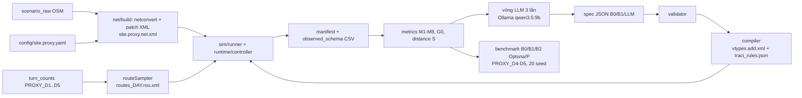

# Báo cáo tình trạng mô phỏng SUMO — 26/10/2026

Repo mô phỏng: `SUMO/` (git riêng, branch `proxy-run`, HEAD `05e2402` lúc 2026-10-26 00:30). Mọi số liệu đều là **proxy, lấy từ literature hoặc giả định** (`site_source: LITERATURE_PROXY`). Chưa có số đo thực nào tại nút Lê Văn Lương × Hoàng Đạo Thúy.

## 0. Tóm tắt

- Phần mô phỏng của pipeline đã chạy được từ đầu đến cuối: mạng → demand → spec → validator → compiler → runtime TraCI → runner + manifest → observed schema.
  - Task 1–9 (trên 15) đã xong.
  - Task 10 (metrics M1–M8, G0, distance) đang làm dở, chưa commit.
  - Vòng LLM, Optuna và benchmark (Task 11–15) chưa bắt đầu.
- **Vấn đề lớn nhất là va chạm trong box.** Với `collision.check-junctions` BẬT, B0 có **42–66 va chạm trong box mỗi 30 phút mô phỏng**, tức khoảng 84–132 va chạm/h.
  - Phần lớn nằm trên các làn nội bộ đi ra từ **lane 2 (làn trái cùng)**.
  - Baseline SUMO thuần (video 2) chạy cùng mạng, cùng đèn, cùng demand thì **0 va chạm**, kể cả khi bật check-junctions.
  - Như vậy va chạm đến từ phần setup hành vi của luận văn (sublane SL2015, xe máy đi song song, xe rẽ trái trái luật), không đến từ mạng, đèn hay demand.
  - Hai ngưỡng va chạm trong `experiment.yaml` vẫn là `null` nên chưa xét được run nào hợp lệ để chọn spec tốt nhất, và chưa vào được vòng LLM.
- Có 2 video, mỗi video 5 phút, cùng khung nhìn và cùng đồng hồ. Mở song song để so sánh (mục 1).

## 1. Hai video

| | Video 1 — setup luận văn | Video 2 — baseline SUMO thuần |
|---|---|---|
| File | `video_1_B0_setup_luan_van_PROXY_D1_seed1.mp4` | `video_2_baseline_SUMO_mac_dinh_PROXY_D1_seed1.mp4` |
| Mạng, đèn, demand | `site.proxy.net.xml`, chu kỳ 120 s, PROXY_D1 | giống video 1 |
| Kiểu xe | spec **B0**: `car`, `moto`, `moto_violator` (custom1), cả ba dùng `SL2015` | **1 vType mặc định cho mỗi loại**: `car` = passenger, `moto` = motorcycle, không thêm thuộc tính nào (LC2013) |
| Mô hình ngang | sublane, `lateral-resolution 0.4` (xe máy đi song song, len vào khe) | không có sublane (xe máy xếp một hàng trong làn như ô tô) |
| Xe rẽ trái trái luật LVL_W | có (217 xe/h; 129 xe trong 1800 s) | **bỏ khỏi routes** vì SUMO cơ bản không có hành vi này |
| Option SUMO | như batch run của repo: check-junctions BẬT, aggregate-warnings, output, detector | mọi option để mặc định SUMO; chỉ giữ `step-length 0.1` (để hai video cùng nhịp frame) và `seed 1` |
| Ô hồng trên mặt đường | detector (induction loop) của `outputs.add.xml` | không có |

Thông số chung của cả hai video:

- sumo-gui 1.27.0, 0–1800 s mô phỏng (07:30–08:00).
- Mỗi frame cách nhau 0,3 s mô phỏng, phát ở 20 fps, tức **tốc độ ×6** và dài 5:00.
- Ảnh 1600×900, khung nhìn 200 m × 112 m quanh tâm nút.
- Màu xe: xanh dương là ô tô, vàng là xe máy. Ở video 1, xe vi phạm được tô đỏ, nhưng ở mức zoom này hình xe máy vốn đã có chi tiết đỏ nên khó phân biệt.
- Overlay hiển thị: đồng hồ, pha đèn kèm giây trong chu kỳ, số xe trong mạng, số xe chờ chèn, số xe đang dừng trên 4 nhánh vào, va chạm và teleport tích lũy. Sau mỗi va chạm, nhãn "VA CHẠM" hiện trong 2 s.
- Vị trí các nhánh trên hình: LVL_W dưới-trái (từ Tố Hữu, nhánh có rẽ trái bị cấm), LVL_E trên-phải, HDT_N trên-trái, HDT_S dưới-phải.

### Kết quả hai run đã quay

Số liệu lấy từ `runs/B0_PROXY_D1_seed01_manifest.json`, `runs/baseline_summary.json` và `runs/baseline_checkjunctions_statistics.xml`.

| | Video 1 (B0) | Video 2 (baseline) | Baseline chạy lại headless, check-junctions BẬT |
|---|---|---|---|
| Xe chèn được trong 1800 s | 4555 | 4426 (ít hơn 129 xe vi phạm đã bỏ) | 4426 |
| Va chạm | **47** (36 `junction`, 11 `side`; 45 trên làn nội bộ) | 0 | **0** |
| Teleport | 47, tất cả do va chạm (jam 0, yield 0) | 0 | 0 |
| Xe còn trong mạng lúc 1800 s | 289 | 445 | 445 |
| Xe dừng trên 4 nhánh vào, trung bình 300–1800 s | 115 (tối đa 244) | 133 (tối đa 261) | — |
| Như trên, chỉ tính 1200–1800 s | 119 | 179 | — |
| Xe trong mạng, trung bình 1200–1800 s | 312 | 390 | — |

Hai hàng "xe dừng" và "xe trong mạng" lấy từ `frames.json`, do recorder ghi qua TraCI ở mỗi frame.

Kiểm chứng tính tái lập: run B0 quay bằng sumo-gui/traci cho đúng kết quả của run headless libsumo mà operator đã chạy ở Task 9 (`experiments/runs/B0__PROXY_D1/seed_01`): 2 va chạm lane, 45 va chạm junction, 47 teleport.

### Nên xem đoạn nào

Mốc thời gian dưới đây là giờ trên video; nhân 6 để ra giây mô phỏng.

- **Video 1, 0:21**: va chạm đầu tiên (t = 130 s), giữa xe vi phạm rẽ trái LVL_W và một xe máy.
- **Video 1, 0:31–0:52 và 3:02–3:32**: hai cụm va chạm dày. Riêng cụm sau có 15 va chạm trong 30 s video.
- **Cả hai video, 3:30–5:00 (07:51–08:00)**:
  - Video 1: xe máy dồn 3–4 xe ngang trong một làn và chen sát vạch dừng, hàng chờ ngắn và dày.
  - Video 2: xe máy xếp một hàng như ô tô nên hàng chờ dài hơn. Trong 10 phút cuối, trung bình 179 xe dừng, so với 119 ở video 1.
- **Video 1, 3:30 (t ≈ 1260 s, LVL đang xanh)**: nhánh LVL_W vẫn còn hàng dài dù đang xanh. Đây là dấu hiệu tắc lane 2 do xe rẽ trái trái luật, khớp với phát hiện R23 trong PROGRESS. Ở video 2 cùng thời điểm, nhánh LVL_W đã xả hết.

## 2. Mục tiêu và pipeline

Luận văn dùng một LLM chạy local để sinh và tinh chỉnh dần **luật hành vi lái xe**, gồm tham số vType và luật TraCI có điều kiện. Mục tiêu là mô phỏng thực tế hơn dòng hỗn hợp ô tô/xe máy giờ cao điểm sáng (07:30–09:00) tại nút LVL × HDT. Trọng tâm là xe máy rẽ trái trái luật dừng chờ trong box.



## 3. Setup hiện tại

### 3.1 Mạng

Nguồn: `scenario/net/site.proxy.net.xml`, `config/site.proxy.yaml`, `scenario/net/edge_table.csv`.

| Nhánh vào | Edge | Hướng | Làn | Dài (m) | Ghi chú |
|---|---|---|---|---|---|
| LVL_W | `711526326#1` | từ SW (vào thành phố) | 3 | 351,6 | rẽ trái **bị cấm** (giả định); chỉ vClass `custom1` được rẽ trái |
| LVL_E | `37876499#0` | từ NE | 3 | 594,2 | |
| HDT_N | `953158817#2` | từ NW | 3 | 437,4 | |
| HDT_S | `1346358303` | từ SE | 3 | 260,7 | |

- Mọi làn rộng 3,5 m, kể cả làn vào, làn ra và làn nội bộ (theo TCVN 13592:2022). Ruling R21 đã sửa lỗi làn ra 3,2 m từng gây va chạm hàng loạt.
- Phân làn (giả định, theo netconvert):
  - lane 0: phải + thẳng;
  - lane 1: thẳng;
  - lane 2: thẳng + trái + quay đầu.
- Theo OSM, làn trái cùng của LVL là làn BRT, nhưng mô hình chưa tách riêng làn này.
- Mạng được cắt trong bán kính 300 m quanh tâm nút.

### 3.2 Đèn tín hiệu

- Đèn cố định, chu kỳ 120 s, 2 pha: LVL xanh 64 s → vàng 4 s → đỏ toàn phần 2 s → HDT xanh 44 s → vàng 4 s → đỏ toàn phần 2 s.
- Chu kỳ 120 s có nguồn (`literature_transferred`): TCCS 24:2018 và số đo 127 s tại nút Láng Hạ × Láng.
- Chia pha 64/44 s và đỏ toàn phần 2 s là **giả định**.

### 3.3 Demand

- Lưu lượng danh nghĩa: LVL_W 2620, LVL_E 2130, HDT_N 1800, HDT_S 1630 xe/h, tổng 8180 xe/h (`data/proxy/targets.yaml`).
- Tỉ lệ xe máy 0,865. Chia hướng thẳng/phải/trái/quay đầu = 0,70/0,15/0,10/0,05.
- 5 "ngày" proxy PROXY_D1–D5 sinh từ cùng một generator, mỗi ngày nhân một hệ số (D1 ×1,128). routeSampler dùng seed 101–105.
- Số xe nạp trong 1800 s: D1 4562, D2 3782, D3 3862.
- Xe rẽ trái trái luật (`moto_violator`, chỉ đi LVL_W → HDT_N): 217 xe/h trên D1.
- Chia dữ liệu: calibration D1–D3, validation D4–D5. LLM và Optuna không bao giờ thấy D4–D5.

### 3.4 Kiểu xe

| Spec | Nội dung |
|---|---|
| **B0** (`rules/compiled/B0/vtypes.add.xml`) | 3 phân phối `car` (passenger), `moto` (motorcycle), `moto_violator` (custom1, chép lại tham số mặc định của motorcycle). Cả ba dùng `SL2015`, mọi tham số khác để mặc định SUMO |
| **B1_manual** (`rules/specs/B1_manual.json`, theo Saval et al. 2023, Bảng 11, Hà Nội) | ô tô: accel 1,2 / decel 4,8 / tau 2,5 / minGap 1,1. Xe máy: accel 1,1 / decel 4,6 / tau 0,8 / minGap 1,9 / minGapLat 0,3. Xe vi phạm: `jmTimegapMinor` 1,0. Có rule `swarm_red_running` (p 0,5); `early_start` để p = 0; không có rule box (R26) |
| **B0_hold3** | B0 + `illegal_left_box` với `release_lag_s = 3`, dùng cho kiểm tra cặp R29. Đã compile, chưa chạy |

Không gian tìm kiếm (`rules/bounds/param_bounds.yaml`):

- 24 thuộc tính vType, mỗi dòng có nguồn trích dẫn.
- `jmIgnoreFoeProb` và `jmIgnoreFoeSpeed` bị loại (R15).
- `minGap` của xe máy trong khoảng [0,5; 2,5] m.

### 3.5 Luật TraCI (`src/thesis_sumo/runtime/rules/`)

| Rule | Hành vi |
|---|---|
| `early_start` | Trong `t_before_green` (0–10 s) cuối pha đỏ, xe đứng đầu bò qua vạch với xác suất `p`, tốc độ ≤ `v_max` |
| `swarm_red_running` | Xe tới vạch khi đèn đỏ thì vượt đèn với p = min(p_max, p0 + k·n), n = số xe đã vượt trong `dt` s |
| `wrong_lane_dodge` | Khi hàng chờ ≥ `q_min`, xe lấn sang làn không đúng hướng. **Không áp dụng được trên mạng proxy** (R27) |
| `illegal_left_box` | Chỉ GIỮ xe đang chờ trong box thêm `release_lag_s` (0–4 s) bằng `setSpeed(0)`. Cấm dùng `ignoreIDs` (R25) |
| `slow_lane_center` | Xe máy chậm giữ lệch một khoảng `lat_offset` so với tim làn |

### 3.6 Thiết lập mô phỏng (`config/experiment.yaml`)

| Mục | Giá trị |
|---|---|
| Bước thời gian | 0,1 s |
| Lateral resolution | 0,4 m |
| Thời gian chạy | 0–1800 s (`calib_end_s`, R31). Run 3600 s trên D1 mất hơn 20 phút |
| Warm-up cho metrics | 300 s |
| `collision.check-junctions` | BẬT (R28) |
| time-to-teleport | mặc định 300 s |
| SSM | tắt; chỉ bật cho tập chẩn đoán của benchmark |
| Backend | libsumo cho batch, traci cho GUI |
| Seed | dev 1–3; benchmark 20 seed |
| Cổng GEH | GEH < 5 ở ít nhất 85 % ô |

### 3.7 Metrics và target (`data/proxy/targets.yaml`)

| Metric | Target proxy | Nguồn |
|---|---|---|
| M1 headway xả bão hòa của xe máy | 0,254 s (CV 0,56) | literature_transferred |
| M2 tỉ lệ xe máy xuất phát sớm | LVL 9,45 %, HDT 15,82 % | literature_transferred |
| M3 tỉ lệ xe máy vượt đèn đỏ | LVL 6,49 %, HDT 11,06 % | literature_transferred |
| M4 tỉ lệ xe máy vượt vạch dừng khi chờ | 63 % | literature_transferred |
| M5 diện tích hàng chờ mỗi xe | xe máy 2,6 m², ô tô 17,4 m² | assumed |
| M6 tốc độ tiếp cận / qua nút của xe máy | 27,3 / 21,3 km/h | literature_transferred |
| M7a số xe chờ trong box mỗi chu kỳ | 6,0; tỉ lệ thoát sớm 20 % | assumed |
| M7b box clear lag (PET proxy) | 5,65 s | assumed |
| M8 tỉ lệ đi sai làn | xe máy 25 %, ô tô 5 % | assumed |

### 3.8 Nguồn dữ liệu

- **Có nguồn (literature hoặc literature_transferred):** bề rộng làn, chu kỳ đèn, tỉ lệ xe máy, target M1–M4 và M6.
- **Giả định:** cấm rẽ trái ở LVL_W, vạch phân làn, chia pha 64/44 s, đỏ toàn phần, lưu lượng từng nhánh, tỉ lệ rẽ, toàn bộ target M5, M7, M8.
- **Đo thực:** chưa có gì.
- **Còn để trống:**
  - `config/site.yaml` (file cho số đo thực) vẫn `TODO_MEASURE` ở: bề rộng làn, vạch làn, cấm rẽ, chu kỳ và pha đèn, nhánh có xe rẽ trái trái luật.
  - `config/llm.yaml` vẫn `TODO_DECIDE`: base_url, model, temperature, n_samples, v.v.
  - Trong `experiment.yaml`, `budget.sumo_runs` và `score.weights` vẫn là `null`.

## 4. Tiến độ (`SUMO/docs/PROGRESS.md`)

| # | Task | Trạng thái |
|---|---|---|
| 1 | Config + site proxy | ✅ |
| 2 | Mạng (Phase 1) | ✅ |
| 3 | vType B0, demand, sumocfg | ✅ |
| 4 / 4b | Runner, manifest, observed schema; sửa bề rộng làn ra, SSM | ✅ |
| 5 | Thí nghiệm chờ trong box (Phase 3), chốt chế độ native | ✅ |
| 6 | Target proxy + generator D1–D5 | ✅ |
| 7 | Param bounds, schema, validator, B1 | ✅ |
| 8 | Compiler | ✅ |
| 9 | Runtime TraCI + 5 rule | ✅ phần code. Việc đo lại ngưỡng va chạm (R28) **bị dừng giữa chừng**: xong 8/9 run, run D3 seed 1 bị kill |
| 10 | Metrics M1–M8, G0, distance | 🔄 10 file `metrics/*.py` và `tests/test_metrics.py` chưa commit; chưa có `distance.py` |
| 11–15 | Harness, LLM client/prompt, vòng LLM, Optuna B2, benchmark + báo cáo | ⏳ |

- Lần chạy test suite gần nhất ghi trong PROGRESS (sau Task 9): 221 passed, 1 xfailed. Hôm nay không chạy lại.
- `SUMO/README.md` chưa cập nhật: mục Status vẫn chỉ tick Phase 0.

## 5. Kết quả số đã có

### 5.1 B0 với check-junctions BẬT (R28), 1800 s

Nguồn: `SUMO/experiments/runs/B0__PROXY_D*/seed_*/manifest.json`.

| Ngày / seed | Va chạm lane | Va chạm junction | Teleport (tất cả / jam+yield) | Backlog cuối | Wall (s) |
|---|---|---|---|---|---|
| D1 / 1 | 2 | 45 | 47 / 0 | 0 | 196 |
| D1 / 2 | 3 | 66 | 69 / 0 | 0 | 184 |
| D1 / 3 | 2 | 44 | 50 / 4 | 0 | 290 |
| D2 / 1 | 0 | 47 | 47 / 0 | 0 | 94 |
| D2 / 2 | 0 | 44 | 44 / 0 | 0 | 96 |
| D2 / 3 | 1 | 57 | 62 / 4 | 0 | 169 |
| D3 / 1 | — (bị kill) | — | — | — | — |
| D3 / 2 | 0 | 57 | 57 / 0 | 0 | 106 |
| D3 / 3 | 1 | 42 | 43 / 0 | 0 | 104 |

Hôm nay đã phân tích 411 bản ghi va chạm (`collisions.xml`) của 8 run trên:

- **Theo loại:** `junction` 370 (90 %), `side` 38, `collision` (đâm đuôi) 3.
- **Theo cặp xe:** xe máy–xe máy 285 (69 %), xe vi phạm–xe máy 44, xe máy–ô tô 28, ô tô–xe máy 22, xe vi phạm–ô tô 17.
- **Theo làn nội bộ (map qua sumolib):**

  | Làn nội bộ | Số va chạm |
  |---|---|
  | LVL_W lane 2, đi thẳng | 117 (28 %) |
  | LVL_W lane 2, rẽ trái trái luật | 53 |
  | LVL_E lane 2, đi thẳng | 43 |
  | HDT_S lane 2, đi thẳng | 37 |
  | LVL_W lane 2, quay đầu | 25 |
  | HDT_N lane 2, rẽ trái | 22 |
  | HDT_N lane 2, đi thẳng | 21 |
  | HDT_S lane 2, rẽ trái | 20 |

  Gần như mọi va chạm đều trên các làn nội bộ đi ra từ **lane 2**, nơi thẳng, trái và quay đầu dùng chung một làn vào.

### 5.2 Các kết quả trước đó (theo PROGRESS)

- **B0 với check-junctions TẮT (Task 4b):** chỉ 0–6 va chạm/h (trung bình 1,56/h), nhưng 7/9 run có teleport do kẹt (jam/yield); chỉ D3 seed 1 và seed 3 đạt `valid_strict`.
  - Nguyên nhân kẹt (R23): 217 xe rẽ trái trái luật ở LVL_W làm tắc lane 2. Bỏ các xe này thì số teleport còn 0/0/3.
- **Khi bật check-junctions:** teleport do kẹt gần như hết (0–4), thay vào đó là teleport do va chạm. [Suy luận] Va chạm kèm teleport đang thay chỗ cơ chế kẹt + teleport cũ để "gỡ" nút.
- **GEH:** 92–100 % ô đạt GEH < 5. Tuy nhiên số "quan sát" cũng sinh từ cùng generator, nên kết quả này gần như hiển nhiên.
- **Sức chứa box (Phase 3, box 3,5 m):** 7–13 xe trái luật dừng trong box (target trung bình 6, p90 10), xếp 3 hàng ngang. Xe thoát box 4,0–5,1 s sau khi hướng đối diện chuyển vàng.
- **Tỉ lệ thoát sớm khỏi box:** B0 14,6 %; với `jmTimegapMinor` 0,5 là 38,1 % (target 20 %; mới chạy 1 seed).
- **B1 trên D1, 600 s, check-junctions BẬT:** 13 va chạm junction trong 600 s. Chỉ có 628 xe đi hết hành trình, so với 1050 xe khi check-junctions TẮT.

## 6. Đánh giá sơ bộ

**Đã làm tốt**

- **Tái lập tốt:**
  - Mỗi run ghi manifest kèm hash của mạng, routes, spec và site.
  - Run quay bằng GUI cho đúng từng con số của run headless (mục 1).
  - Mạng được sinh bằng script cộng các patch XML, không sửa tay `.net.xml`.
- **Nguồn dữ liệu được dán nhãn rõ:** mọi tham số đều ghi literature, transferred hay assumed; giá trị chưa đo để `null` thay vì tự điền.
- **Sublane B0 thể hiện được "chất" xe máy Hà Nội mà SUMO thuần không có:** xe máy đi song song, len khe, dồn đầu vạch dừng, nên hàng chờ ngắn và dày hơn. Trong 10 phút cuối có 119 xe dừng, so với 179 ở baseline (mục 1). Đây là luận cứ trực quan cho việc dùng sublane.

**Vấn đề, xếp theo mức nghiêm trọng**

1. **Va chạm trong box với check-junctions BẬT là điểm chặn số 1.**
   - B0 có 42–66 va chạm / 30 phút, còn baseline thuần có 0.
   - Va chạm tập trung ở các làn nội bộ dùng chung từ lane 2.
   - [Suy luận] Nguyên nhân có thể là xe máy sublane đi song song trên những làn nội bộ tách ra từ cùng một làn vào, rồi giao nhau trong box.
   - Teleport do va chạm làm xe "biến mất" khỏi xung đột, nên các metric hàng chờ (M5) và thời gian qua nút (M6) của B0 đang bị làm đẹp đi.
   - Ngưỡng `max_collisions_per_hour` và `max_junction_collisions_per_hour` vẫn `null`. Nếu áp công thức R24 lên 8 run hiện có thì ngưỡng junction sẽ khoảng 120/h; một ngưỡng như vậy gần như không còn tác dụng lọc.
2. **Toàn bộ dữ liệu là proxy.**
   - D1–D5 sinh từ cùng một generator, nên chỉ số R = d_sim_obs / d_day_day và GEH chỉ mang tính minh họa.
   - Các kết luận "thực tế hơn" chưa thể bảo vệ trước hội đồng nếu chưa có số đo thực tại nút: đếm lưu lượng, pha đèn, bề rộng làn, số xe chờ trong box từ video hiện trường.
3. **Chỉ mô phỏng 07:30–08:00** (R31), chưa bao trọn khung 07:30–09:00 như mục tiêu.
4. **Hai đòn bẩy không dùng được trên mạng proxy:** `wrong_lane_dodge` không áp dụng được, nên M8 chỉ đo được qua vị trí ngang. B1 không có rule box.
5. **Còn nhiều quyết định mở:** `budget.sumo_runs`, `score.weights`, toàn bộ `llm.yaml`. Task 10 chưa commit; R29 và R33 chưa chạy.
6. **Thời gian chạy:** một run D1 1800 s mất 3–8 phút headless và khoảng 13 phút khi quay GUI. Theo design, budget 36 run cho mỗi phương pháp vẫn khả thi.

**Kết luận sơ bộ:** phần hạ tầng mô phỏng (Task 1–9) đã chắc và tái lập được. Rủi ro chính nằm ở chất lượng mô hình nền B0: va chạm trong box và dữ liệu proxy. Nên xử lý điểm chặn số 1 trước khi tốn budget cho vòng LLM.

## 7. Việc nên làm tiếp

1. Chạy lại D3 seed 1, chốt hai ngưỡng va chạm theo R24/R28 và commit trước vòng 1.
2. Điều tra nguyên nhân va chạm junction bằng các thí nghiệm nhỏ, mỗi lần chỉ đổi một yếu tố so với B0 trên D1, check-junctions BẬT:
   - bỏ xe vi phạm;
   - tắt sublane (bỏ `--lateral-resolution`);
   - tách lane 2 thành làn chỉ để thẳng hoặc chỉ để rẽ.

   Run baseline trong báo cáo này chính là trường hợp "đổi tất cả cùng lúc" và cho 0 va chạm. Mọi option SUMO định dùng phải kiểm tra bằng `sumo --help` trước (CLAUDE.md).
3. Commit Task 10 (metrics) và viết `distance.py`. Sau đó chạy metrics cho cả B0 và baseline thuần, để có thêm một mốc so sánh định lượng: "SUMO thuần" so với B0 so với P.
4. Chốt `budget.sumo_runs`, `score.weights` và `llm.yaml`, rồi làm Task 11–12.
5. Lên kế hoạch thu dữ liệu thực tại nút (video hiện trường giờ cao điểm sáng) để thay `site.proxy.yaml` và PROXY_D*.
6. Cập nhật mục Status trong `SUMO/README.md`.

## Phụ lục — nội dung thư mục

| File | Nội dung |
|---|---|
| `README.md` | báo cáo này |
| `video_1_B0_setup_luan_van_PROXY_D1_seed1.mp4` | video 5 phút, setup luận văn (B0) |
| `video_2_baseline_SUMO_mac_dinh_PROXY_D1_seed1.mp4` | video 5 phút, SUMO thuần |
| `runs/B0_PROXY_D1_seed01_manifest.json`, `runs/B0_PROXY_D1_seed01_collisions.xml` | manifest và danh sách va chạm của run đã quay ở video 1 |
| `runs/baseline_*` | sumocfg, vType, thống kê, tóm tắt của run baseline; `baseline_checkjunctions_statistics.xml` là kết quả chạy lại headless với check-junctions BẬT |
| `scripts/record_video.py` | quay sumo-gui qua TraCI (chạy bằng `SUMO/.venv`); `--plain-sumo` để tạo baseline |
| `scripts/encode_video.py` | thêm overlay và xuất MP4 (Pillow, PyYAML, imageio-ffmpeg) |

Tái tạo, chạy từ thư mục `Thesis/`:

```bash
SUMO/.venv/Scripts/python.exe report/2026-10-26/scripts/record_video.py --spec B0 --day PROXY_D1 --seed 1 --end 1800 --every 3 --out report/2026-10-26/_rec
SUMO/.venv/Scripts/python.exe report/2026-10-26/scripts/record_video.py --plain-sumo --day PROXY_D1 --seed 1 --end 1800 --every 3 --out report/2026-10-26/_rec_plain
python report/2026-10-26/scripts/encode_video.py --rec report/2026-10-26/_rec --out report/2026-10-26/video_1_B0_setup_luan_van_PROXY_D1_seed1.mp4 --title "B0 setup luận văn (sublane SL2015, xe rẽ trái trái luật) · PROXY_D1 · seed 1"
python report/2026-10-26/scripts/encode_video.py --rec report/2026-10-26/_rec_plain --out report/2026-10-26/video_2_baseline_SUMO_mac_dinh_PROXY_D1_seed1.mp4 --no-violators --title "BASELINE SUMO thuần (car/motorcycle mặc định, không sublane) · PROXY_D1 · seed 1"
```

Ghi chú kỹ thuật về quay video:

- **Lỗi gặp phải:** sumo-gui 1.27 trên Windows bị **deadlock** khi chụp màn hình liên tục qua TraCI.
  - `GUIApplicationWindow::handleEvent_SimulationStep` bỏ qua các step event đến cách nhau dưới 20 ms.
  - Trong khi đó `GUIRunThread::waitForSnapshots` vẫn chờ ảnh chụp, nên cả hai đứng chờ nhau.
- **Cách tránh trong `record_video.py`:**
  - nghỉ 30 ms sau mỗi lệnh chụp;
  - một watchdog đổi kích thước cửa sổ 1 px khi ảnh bị trễ, vì `onConfigure` cũng gọi `checkSnapshots`.
  - Kết quả: video 1 cần 27 lần nudge, video 2 cần 2 lần, không mất frame.
